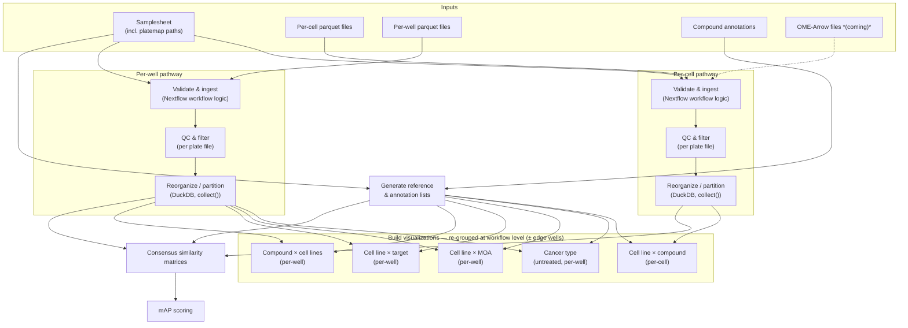

# Planning for PCCMA-nf workflow.

For reference, here is an image of the whiteboard we created when working through the workflow planning.

## Pipeline Outline

This pipeline processes Cell Painting morphological profiling data from CytoTable through QC, dimensionality reduction, and similarity-based scoring.
There are two parallel input pathways: **per-cell** (primary, more complex) and **per-well summary statistics**.
A third possible input format is **OME-Arrow**, which bundles per-cell morphological features together with cell images.

## Key Python Packages

Most processing steps are implemented in Python.
The primary packages expected to be used are:

- **[polars](https://pola.rs/)** / **[pyarrow](https://arrow.apache.org/docs/python/)** — parquet I/O and data manipulation
- **[pycytominer](https://github.com/cytomining/pycytominer)** — core morphological profiling operations: feature selection, normalization, aggregation, and consensus profile generation
- **[OME-Arrow](https://github.com/WayScience/ome-arrow)** — reading OME-Arrow files that bundle per-cell images with morphological features
- **[coSMicQC](https://github.com/WayScience/coSMicQC)** — QC filtering of wells and cells based on CellProfiler-derived metrics
- **[copairs](https://github.com/cytomining/copairs)** — pairwise similarity comparisons and mAP scoring
- **[umap-learn](https://umap-learn.readthedocs.io/)** — UMAP dimensionality reduction for visualizations
- **[scipy](https://scipy.org/)** — hierarchical clustering (for dendrogram / Newick output in visualizations)
- **[duckdb](https://duckdb.org/)** — efficient multi-file parquet joins and partitioned writes for the reorganization step

## Inputs

Data downloaded from the Cell Painting Gallery (CPG) (or equivalent) after processing with CytoTable, plus some additional annotation files, will be the primary inputs to the pipeline.
The expected inputs are:

- **Per-cell parquet files** — one or more parquet files per plate (e.g., normalized, feature-selected variants), organized on CPG as `workspace/profiles/<batch>/<plate>/<plate_name>.parquet`; each row is a single cell with morphological feature columns
- **Per-well parquet or csv files** — summary statistics aggregated to the well level (one row per well); location TBD (Usually in `workspace/backend/` as CSVs on CPG, but parquet output location needs to be confirmed)
- _(possibly)_ **OME-Arrow files** — alternative format that includes per-cell images alongside morphological features
- **Samplesheet** — List of plate files to use, including information about batch, timepoint, and other relevant metadata.
- **Plate metadata** — Platemap files with per-well metadata (cell line, compound, concentration, etc.) that can be joined to the per-cell and per-well data based on plate and well identifiers.
  These should be found in the `workspace/metadata` directory on CPG
- **Compound annotation files** — MOA (mechanism of action) and target dictionaries mapping compound names to biological annotations

## Processing steps

### Validate and ingest inputs

The pipeline takes a samplesheet listing the batches and plates to be processed, along with the root path to the Cell Painting Gallery data.
It should discover all parquet files matching the expected `workspace/profiles/<batch>/<plate>/` subdirectory pattern and cross-references them against the samplesheet to verify that every expected plate has at least one corresponding file.
Any plates listed in the samplesheet but missing from disk should raise a warning or error.

This step is implemented primarily as workflow logic (using `Channel.fromPath`, `splitCsv`, and Groovy operations) rather than a Nextflow process.
The samplesheet should include the path for the corresponding platemap file.

The output is a Nextflow channel in which each element pairs a parquet file path with a metadata map (batch, plate, timepoint, platemap path, etc.) derived from the samplesheet.

- **Input:**
  - Samplesheet (CSV) listing batches and plates to include, with platemap path per plate
  - Per-cell parquet files under `workspace/profiles/<batch>/<plate>/`
  - Per-well parquet files (location TBD)
- **Output:**
  - Validated Nextflow channel of `(metadata, parquet_file, platemap_file)` tuples, one entry per plate file
  - Pipeline-level summary of plates found vs. expected

### QC and filter cells / wells

This step applies QC metrics (e.g., from WayLab / coSMicQC) to flag and remove low-quality wells and/or individual cells.
QC criteria may include cell count thresholds, out-of-focus scores, segmentation quality flags, or other plate-level anomaly metrics.
(Note that this is earlier than the QC step in the whiteboard image, as I think we can filter without needing to do any per-condition grouping first.)

QC runs **per plate file** (one process invocation per plate parquet file), before any partitioning.
Running QC at this stage preserves the full plate context needed for plate-level metric computation — for example, identifying bad wells by comparing them against all other wells on the same plate.
Each invocation produces a filtered parquet file and a per-plate QC report.

- **Input:**
  - `(metadata, parquet_file, platemap_file)` tuples from ingest step
  - QC parameters/thresholds
- **Output:**
  - `(metadata, filtered_parquet_file, platemap_file)` tuples (one per input file, bad wells/cells excluded)
  - Per-plate QC report with pass/fail counts and other relevant metrics

### Reorganize / partition data

All QC-filtered plate files are collected and partitioned in a single process invocation using DuckDB.
DuckDB joins each plate file with its corresponding platemap and writes a globally partitioned dataset in one pass, outputting exactly one parquet file per `(cell_line, compound, timepoint)` combination.

- **Input:**
  - All `(metadata, filtered_parquet_file, platemap_file)` tuples collected into a single list via `collect()`
- **Output:**
  - Hive-partitioned parquet files under `partitions/cell_line=X/compound=Y/timepoint=Z/` (one file per condition)

This output can be transformed into a Nextflow channel of `(cell_line, compound, timepoint, partition_file)` tuples discovered via `Channel.fromPath` + `map`

### Generate reference / annotation lists

Before branching into per-condition analyses, the pipeline compiles the complete set of unique experimental entities present in the dataset and maps them to external biological annotations.
Cell line and compound lists are derived directly from the plate metadata.
MOA and target mappings are joined from the compound annotation input files, filtered to only compounds that actually appear in the dataset.
These reference files are used by later steps to define analysis groupings, label similarity matrices, and score mAP results.

- **Input:**
  - Plate metadata (from samplesheet)
  - Compound annotation files (MOA and target dictionaries)
- **Output:**
  - `compound_list.tsv` — unique compounds present in the dataset
  - `cell_line_list.tsv` — unique cell lines present in the dataset
  - `moa_dict.tsv` — MOA → compound mapping (filtered to dataset compounds)
  - `target_dict.tsv` — target → compound mapping (filtered to dataset compounds)
  - These outputs should also exist as Groovy objects in the Nextflow workflow for use in downstream steps without needing to read from disk

### Build visualizations

To support exploratory analysis and quality checking, this step generates low-dimensional embeddings and cluster assignments for each analysis grouping.

The per-condition partition files are keyed by `(cell_line, compound, timepoint)`, but each visualization grouping requires a _different_ aggregation of those files.
Before invoking the visualization process, the workflow re-groups the partition-file channel by joining with the reference/annotation lists and applying a new `groupTuple` key for each grouping type:

- **Per-well groupings** (joining with cancer type and MOA/target annotations):
  - All cell lines of the same cancer type (untreated only)
  - All compounds with the same MOA within a cell line
  - All compounds with the same target within a cell line
  - All cell lines for a given compound

- **Per-cell groupings:**
  - All conditions (compound + untreated) within a cell line

Each grouping is then `combine`d with `[true, false]` to produce two channel items — one with edge wells included and one without — before being passed to the visualization process.
This means a single visualization process handles all grouping types; the variation is entirely in how the input channel is constructed in the workflow.

The visualization process creates a UMAP embedding and a hierarchical clustering representation (Newick or JSON format) for each input grouping.

- **Input:**
  - Channel of re-grouped `(grouping_metadata, [partition_files], include_edge_wells)` tuples (constructed at workflow level from partition step output + reference lists)
- **Output:**
  - Channel of `(grouping_metadata, value_matrix, umap_file, clustering_file)` tuples, one per grouping × edge-well setting

### Consensus similarity matrices

We will compute similarity matrices for each cell line across compounds and for each compound across cell lines, using the QC-filtered data.
Detail to come.

### Mean Average Precision (mAP) scoring

Similarly, for a given list of compounds, we will create an mAP table by cell line.
And for each list of cell lines we will create an mAP table by compound.
Detail to come.

## OME-Arrow Data _(coming)_

If input data is provided in OME-Arrow format as expected, we may want to adapt to use that to keep files together. But for now I focused on parquet inputs and outputs.

A question I only just realized is whether well data would also be in OME-arrow format, or just the per-cell data.

## Flowchart

I had a rough flowchart made by Claude; this is just for experimentation as I am not sure it is really useful given the current level of detail. As the Nextflow code is filled in, that can be parsed into a more accurate and continually updated flowchart.

