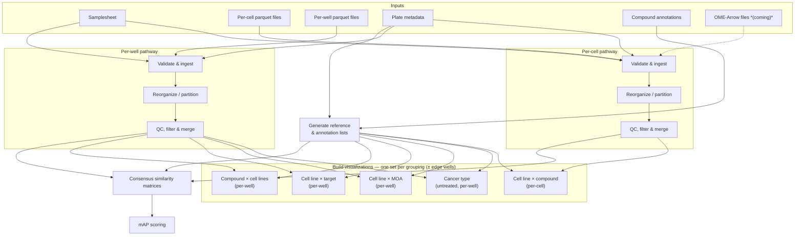

# Planning for PCCMA-nf workflow.

For reference, here is an image of the whiteboard we created when working through the workflow planning.

## Pipeline Outline

This pipeline processes Cell Painting morphological profiling data from CytoTable through QC, dimensionality reduction, and similarity-based scoring.
There are two parallel input pathways: **per-cell** (primary, more complex) and **per-well summary statistics**.
A third possible input format is **OME-Arrow**, which bundles per-cell morphological features together with cell images.

## Inputs

Data downloaded from the Cell Painting Gallery (CPG) (or equivalent) after processing with CytoTable, plus some additional annotation files, will be the primary inputs to the pipeline.
The expected inputs are:

- **Per-cell parquet files** — one or more parquet files per plate (e.g., normalized, feature-selected variants), organized on CPG as `workspace/profiles/<batch>/<plate>/<plate_name>.parquet`; each row is a single cell with morphological feature columns
- **Per-well parquet or csv files** — summary statistics aggregated to the well level (one row per well); location TBD (Usually in `workspace/backend/` as CSVs on CPG, but parquet output location needs to be confirmed)
- _(possibly)_ **OME-Arrow files** — alternative format that includes per-cell images alongside morphological features
- **Samplesheet** — List of plate files to use, including information about batch, timepoint, and other relevant metadata.
- **Plate metadata** — Platemap files with per-well metadata (cell line, compound, concentration, etc.) that can be joined to the per-cell and per-well data based on plate and well identifiers.
  These should be found in the `workspace/metadata` directory on CPG
- **Compound annotation files** — MOA (mechanism of action) and target dictionaries mapping compound names to biological annotations

## Processing steps

### Validate and ingest inputs

The pipeline takes a samplesheet listing the batches and plates to be processed, along with the root path to the Cell Painting Gallery data.
It should discover all parquet files matching the expected `workspace/profiles/<batch>/<plate>/` subdirectory pattern and cross-references them against the samplesheet to verify that every expected plate has at least one corresponding file.
Any plates listed in the samplesheet but missing from disk should raise a warning or error.

The output is a Nextflow channel in which each element pairs a parquet file path with a metadata map (batch, plate, timepoint, etc.) derived from the samplesheet.

- **Input:**
  - Samplesheet (CSV) listing batches and plates to include
  - Per-cell parquet files under `workspace/profiles/<batch>/<plate>/`
  - Per-well parquet files (location TBD)
  - Plate metadata files under `workspace/metadata/` that can be joined to the samplesheet entries based on batch and plate identifiers
- **Output:**
  - Validated Nextflow channel of `(metadata, parquet_file)` tuples, one entry per plate file
  - Pipeline-level summary of plates found vs. expected

### Reorganize / partition data

The per-plate parquet files from CytoTable contain all cells for a given plate, which can include multiple conditions in terms of treatment or cell line.
This step joins each parquet file with its plate metadata and re-partitions the combined data so that downstream analyses can operate on biologically meaningful subsets.

Cells are grouped by the combination of cell line, compound, and timepoint, and each partition is written out as its own parquet file.
This reorganization is the foundation for all subsequent per-condition analyses, which will operate on repartitioned files rather than the original per-plate files.

An initial process will output tuples of cell line, compound, timepoint, and the corresponding partitioned parquet file path.
These will then be grouped into a second channel keyed by `(cell_line, compound, timepoint)` so that all files corresponding to the same condition are grouped together for downstream processing.
We should not need to explicitly regroup the files into single files per condition at this stage; rather, the channel grouping will allow downstream steps to process all relevant files together without needing to merge them on disk.

- **Input:**
  - Per-cell or per-well parquet files (from ingest inputs step)
  - Plate metadata (from samplesheet)
- **Output:**
  - Nextflow channel of `(cell_line, compound, timepoint, [partitioned_parquet_files])` tuples where the metadata includes cell line and compound information.
  - We may want to include a list of metadata tuples as well for each of the partitioned files?

### Generate reference / annotation lists

Before branching into per-condition analyses, the pipeline compiles the complete set of unique experimental entities present in the dataset and maps them to external biological annotations.
Cell line and compound lists are derived directly from the plate metadata.
MOA and target mappings are joined from the compound annotation input files, filtered to only compounds that actually appear in the dataset.
These reference files are used by later steps to define analysis groupings, label similarity matrices, and score mAP results.

- **Input:**
  - Plate metadata (from samplesheet)
  - Compound annotation files (MOA and target dictionaries)
- **Output:**
  - `compound_list.tsv` — unique compounds present in the dataset
  - `cell_line_list.tsv` — unique cell lines present in the dataset
  - `moa_dict.tsv` — MOA → compound mapping (filtered to dataset compounds)
  - `target_dict.tsv` — target → compound mapping (filtered to dataset compounds)
  - These outputs should also exist as Groovy objects in the Nextflow workflow for use in downstream steps without needing to read from disk

### QC and filter cells / wells

This step applies QC metrics (e.g., from WayLab / coSMicQC) to flag and remove low-quality wells and/or individual cells.
QC criteria may include cell count thresholds, out-of-focus scores, segmentation quality flags, or other plate-level anomaly metrics.
The step produces a filtered version of the partitioned data in which flagged wells are excluded, along with a per-plate QC report summarizing pass/fail counts so that the extent of data loss can be audited.

- **Input:**
  - channel of reorganized per-cell parquet files (from reorganize/partition step)
  - QC metric files providing well-level pass/fail or numeric quality scores (from per-well data or external QC pipeline)
- **Output:**
  - Nextflow channel `(cell_line, compound, timepoint, merged_parquet_file)` — per-plate files are merged into a single parquet file per condition after filtering (bad wells and/or cells excluded)
  - QC summary report with per-plate and per-well pass/fail counts and other relevant metrics

### Build visualizations

To support exploratory analysis and quality checking, this step generates low-dimensional embeddings and cluster assignments for each analysis partition.

The visualization step will take in a set of of parquet files that include all cells or wells for a given condition of interest, e.g., untreated cells from all cancer types (a more complete list will appear below).
The input data will have the form of a matrix of well or cell × feature values.

This process will create a UMAP embedding of the wells or cells, as well as a representation of the hierarchical clustering structure of the data (Newick or JSON format).

For bulk/per well analyses, we will create the following sets of visualizations:

- All samples for a given cancer type (untreated only)
- Each cell line for each mechanism of action (MOA) (all compounds with the same MOA within a cell line)
- Each cell line for each drug target (all compounds with the same target)
- Each compound across all cell lines (all samples treated with a given compound across cell lines)

For individual cell visualizations, we will create the following sets:

- Each cell line for each compound (plus untreated)

Each analysis will be done with and without edge wells included.

- **Input:**
  - channel of merged per-condition parquet files (from QC step)
- **Output:**
  - Channel of [metadata (including info on groupings and whether edge wells are included), value matrix, UMAP embedding file, hierarchical clustering file] tuples, one per analysis grouping

### Consensus similarity matrices

We will compute similarity matrices for each cell line across compounds and for each compound across cell lines, using the QC-filtered data.
Detail to come.

### Mean Average Precision (mAP) scoring

Similarly, for a given list of compounds, we will create an mAP table by cell line.
And for each list of cell lines we will create an mAP table by compound.
Detail to come.

## OME-Arrow Data _(coming)_

If input data is provided in OME-Arrow format as expected, we may want to adapt to use that to keep files together. But for now we will focus on parquet inputs and outputs.

A question I only just realized is whether well data would also be in OME-arrow format, or just the per-cell data.
