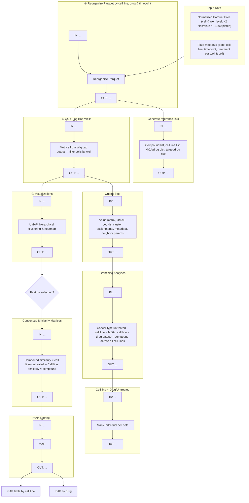

# Planning for PCCMA-nf workflow.

For reference, here is an image of the whiteboard we created when working through the workflow planning.

I had Claude make a flowchart of this, with a bit of tweaking.
I'm including it here as the first step, but I plan to work on it more to flesh things out and organize it better in future commits.
For now, I just want it recorded here.

