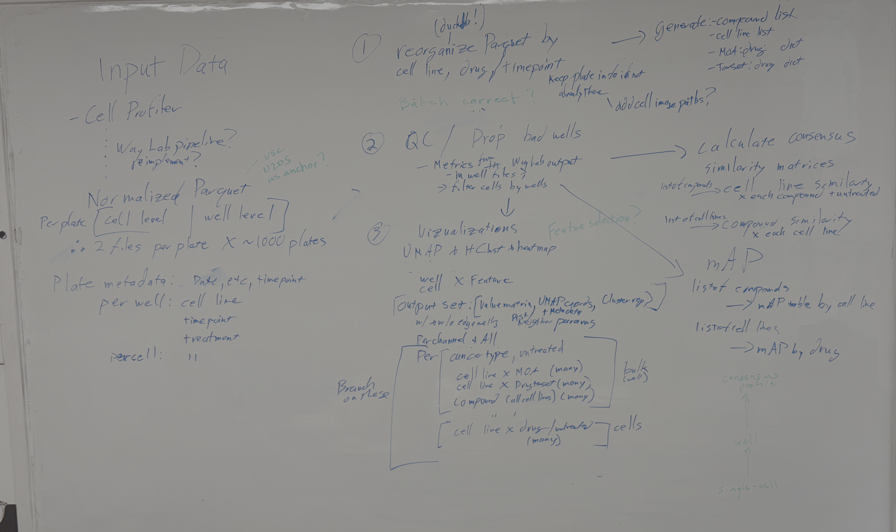
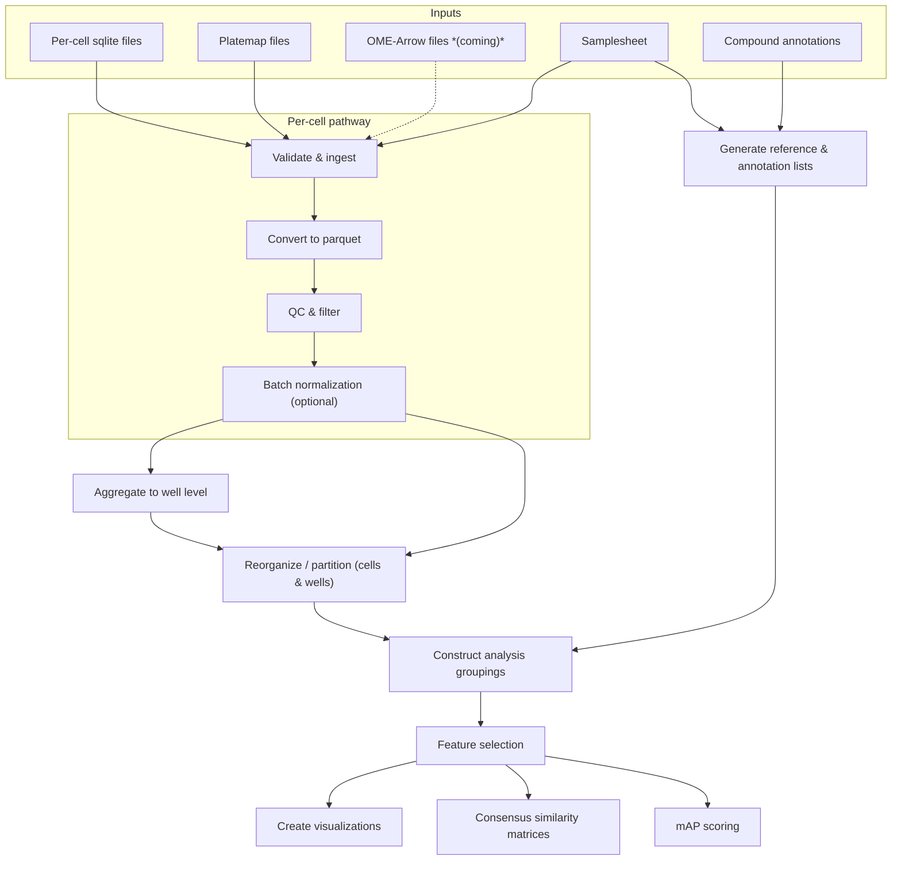

# Planning for PCCMA-nf workflow.

For reference, here is an image of the whiteboard we created when working through the workflow planning.

## Pipeline Outline

This pipeline processes Cell Painting morphological profiling data from CytoTable through QC, dimensionality reduction, and similarity-based scoring.
The primary input is **per-cell** sqlite files (or potentially other formats as this might be changing to parquet in some versions, but we will assume sqlite for now).
Well-level summary statistics will be derived from the per-cell data within the pipeline as needed (in contrast to the description on the whiteboard, which shows them as separate inputs).
It is likely we will also get `OME-Arrow` files, which bundle per-cell morphological features together with cell images.
These should be convertible to `OME-parquet` format, which I think will let us still use some of the on-disk capabilities of DuckDB, but we will see what is needed on that front.

## Key Python Packages

Most processing steps are implemented in Python.
The primary packages expected to be used are:

- **[CytoTable](https://github.com/cytomining/cytotable)** -- reading Cell Painting data from sqlite files, and conversion to parquet format.
- **[Pycytominer](https://github.com/cytomining/pycytominer)** -- core morphological profiling operations: feature selection, normalization, aggregation, and consensus profile generation
- **[OME-Arrow](https://github.com/WayScience/ome-arrow)** -- reading OME-Arrow files that bundle per-cell images with morphological features
- **[coSMicQC](https://github.com/WayScience/coSMicQC)** -- QC filtering of wells and cells based on CellProfiler-derived metrics
- **[copairs](https://github.com/cytomining/copairs)** -- pairwise similarity comparisons and mAP scoring
- **[umap-learn](https://umap-learn.readthedocs.io/)** -- UMAP dimensionality reduction for visualizations
- **[scipy](https://scipy.org/)** -- hierarchical clustering (for dendrogram / Newick output in visualizations)
- **[DuckDB](https://duckdb.org/)** -- per-plate platemap joins and partitioned parquet writes in the reorganization step

## Inputs

Data downloaded from the Cell Painting Gallery (CPG) (or equivalent) after processing with CytoTable, plus some additional annotation files, will be the primary inputs to the pipeline.
The expected inputs are:

- **Per-cell sqlite files** — one sqlite file per plate, organized on CPG as `workspace/backend/`.
- _(possibly)_ **OME-Arrow files** — alternative format that includes per-cell images alongside morphological features
- **Platemap files** — Platemap files with per-well metadata (cell line, compound, concentration, etc.) that can be joined to the per-cell data based on plate and well identifiers.
  These should be found in the `workspace/metadata/` directory on CPG
- **Samplesheet** — Table with one row per plate, including the location of plate data file, the associated platemap file, and other associated metadata such as batch, timepoint, etc.
- **Compound annotation files** — MOA (mechanism of action) and target dictionaries mapping compound names to biological annotations

## Processing steps

### Validate and ingest inputs

The pipeline takes a samplesheet listing the batches and plates to be processed, along with the root path to the Cell Painting Gallery data.
It should check for all sqlite files matching the expected `workspace/backend/<batch>/<plate>/` subdirectory pattern and cross-reference them against the samplesheet to verify that every expected plate has at least one corresponding file.
Any plates listed in the samplesheet but missing from disk should raise a warning or error.

This step is implemented primarily as workflow logic (using `Channel.fromPath`, `splitCsv`, and Groovy operations) rather than a Nextflow process.
The samplesheet should include the path for the corresponding platemap file.

The output is a Nextflow channel in which each element pairs each plate data file and platemap file with a metadata map (batch, plate, timepoint, platemap path, etc.) derived from the samplesheet.

- **Input:**
  - Samplesheet (CSV) listing batches and plates to include, with platemap path per plate
  - Per-cell sqlite files under `workspace/backend/`
- **Output:**
  - Validated Nextflow channel of `(metadata, sqlite_file, platemap_file)` tuples, one entry per plate file
  - Pipeline-level summary of plates found vs. expected

### Convert to parquet format

Before any processing, the per-cell data is converted from sqlite to parquet format.
The sqlite files from CellProfiler can be in a couple of formats, so the very first step is going to be to make sure everything is in a consistent parquet format that we can work with for the rest of the pipeline.

For this we will use CytoTable to ensure that all of the data is collated and written out in a consistent parquet format.
This step runs **per plate file** (one process invocation per plate sqlite file), and produces a parquet file with one row per cell and columns for all morphological features and metadata (plate, well, cell ID, etc.).
The output parquet file is passed forward to the QC step.

- **Input:**
  - `(metadata, sqlite_file)` tuples from ingest step
  - Any parameters needed for the conversion (e.g., expected column names, feature prefixes to include/exclude, etc.)
- **Output:**
  - `(metadata, parquet_file)` tuples (one per input file, with the per-cell data now in parquet format)

### QC and filter cells / wells

This step applies QC metrics (e.g., from Way Lab / coSMicQC) to flag and remove low-quality wells and/or individual cells.
QC criteria may include cell count thresholds, out-of-focus scores, segmentation quality flags, or other plate-level anomaly metrics.
(Note that this is earlier than the QC step in the whiteboard image, as I think we can filter without needing to do any per-condition grouping first.)

If we need to perform per-plate normalization, this would be done at this stage as well.

QC runs **per plate file** (one process invocation per plate parquet file), before any partitioning.
Running QC at this stage preserves the full plate context needed for plate-level metric computation — for example, identifying bad wells by comparing them against all other wells on the same plate.
Each invocation produces a filtered parquet file and a per-plate QC report.

- **Input:**
  - `(metadata, parquet_file, platemap_file)` tuples from conversion step, with platemap file added based on metadata
  - QC parameters/thresholds
- **Output:**
  - `(metadata, filtered_parquet_file, platemap_file)` tuples (one per input file, bad wells/cells excluded)
  - Per-plate QC report with pass/fail counts and other relevant metrics

### Batch normalization

We may also want to perform batch normalization among plates within a batch.
However, this remains an open scientific question at the moment.
We may want to have the option to run with or without batch normalization at this point, and perhaps experiment with different normalization approaches.
Alternatively, we can branch here, with and without batch normalization, and carry both versions through the rest of the pipeline for comparison.

Plates are grouped by batch, and within each batch, the DMSO wells on U2OS plates are used to compute a reference profile; all plates in the batch are then normalized relative to that reference using pycytominer's `normalize()` function.
The output is a set of batch-normalized per-plate parquet files.
After this step, plates from different batches are combined via `collect()` and passed to the partition step.

- **Input:**
  - All `(metadata, filtered_parquet_file, platemap_file)` tuples for a given batch (grouped by batch key via `groupTuple`)
  - U2OS cell line designation (used to identify the reference plates within the batch)
- **Output:**
  - `(metadata, batch_normalized_parquet_file, platemap_file)` tuples (one per input plate, now batch-normalized)
  - Per-batch normalization report (U2OS reference profile used, plates normalized)

### Compute well-level summaries

Well-level summary profiles are aggregated from the batch-normalized per-plate files using pycytominer's `aggregate()` function (median aggregation by default).
This step runs **per plate file** — one process invocation per plate — and produces a per-plate well-summary file with one row per well.
Aggregation happens here, before partitioning, because it is naturally a per-plate operation: each well belongs to exactly one plate, so grouping cells by well within a plate file is the correct scope.
Computing well summaries at this stage also reduces the data volume that flows into the per-plate partition step.

- **Input:**
  - `(metadata, batch_normalized_parquet_file, platemap_file)` tuples (one per plate, from batch normalization)
- **Output:**
  - `(metadata, well_summary_file, platemap_file)` tuples (one per plate, one row per well)
  - These flow into the partition step alongside the per-cell files

### Reorganize / partition data

Per-cell and well-summary plate files are each partitioned per plate using a DuckDB process (one process invocation per plate file, run in parallel).
DuckDB joins each plate file with its corresponding platemap and writes out one parquet file per `(cell_line, compound, timepoint)` combination present in that plate.
Both per-cell and well-summary data use the same partition keys, keeping the two datasets structurally parallel.

Running partitioning per plate (rather than after a global `collect()`) avoids a pipeline-wide bottleneck: each plate's condition files can flow into downstream grouping steps as soon as that plate is processed.
Joining at the plate level is also the natural scope, since each plate already travels with its own platemap.
The downstream "Construct analysis groupings" step uses `groupTuple` to assemble all per-plate files for a given condition combination, so the multi-file-per-condition structure is handled there.

- **Input:**
  - `(metadata, batch_normalized_parquet_file, platemap_file)` tuples, one per plate (per-cell)
  - `(metadata, well_summary_file, platemap_file)` tuples, one per plate (well-summary)
- **Output:**
  - For each plate: per-cell parquet files written under `partitions/cells/cell_line=X/compound=Y/timepoint=Z/`
  - For each plate: well-summary parquet files written under `partitions/wells/cell_line=X/compound=Y/timepoint=Z/`

Because a Nextflow process emits one channel item per invocation, the list of partition files from each plate arrives as a single item.
A `.flatMap()` step in the workflow expands that list into individual `(cell_line, compound, timepoint, plate_partition_file)` tuples by parsing the partition keys out of each file path.
This produces multiple tuples per condition across plates, which then accumulate naturally via `groupTuple` in the analysis groupings step.

### Generate reference / annotation lists

Before branching into per-condition analyses, the pipeline compiles the complete set of unique experimental entities present in the dataset and maps them to external biological annotations.
Cell line and compound lists are derived directly from the plate metadata.
MOA and target mappings are joined from the compound annotation input files, filtered to only compounds that actually appear in the dataset.
These reference files are used by later steps to define analysis groupings, label similarity matrices, and score mAP results.

- **Input:**
  - Plate metadata (from samplesheet)
  - Compound annotation files (MOA and target dictionaries)
- **Output:**
  - `compound_list.tsv` — unique compounds present in the dataset
  - `cell_line_list.tsv` — unique cell lines present in the dataset
  - `moa_dict.tsv` — MOA → compound mapping (filtered to dataset compounds)
  - `target_dict.tsv` — target → compound mapping (filtered to dataset compounds)
  - These outputs should also exist as Groovy objects in the Nextflow workflow for use in downstream steps without needing to read from disk

### Construct analysis groupings

The per-condition partition files are keyed by `(cell_line, compound, timepoint)`, but each visualization grouping requires a _different_ aggregation of those files.
Before invoking the visualization process, the workflow re-groups the partition-file channel by joining with the reference/annotation lists and applying a new `groupTuple` key for each grouping type.
Well-summary groupings draw from the well-summary partition channel; per-cell groupings draw from the per-cell partition channel.

- **Well-summary groupings** (joining with cancer type and MOA/target annotations):
  - All cell lines of the same cancer type (untreated only)
  - All compounds with the same MOA within a cell line
  - All compounds with the same target within a cell line
  - All cell lines for a given compound

- **Per-cell groupings:**
  - All conditions (compound + untreated) within a cell line

Each grouping is then `combine()`d with `[true, false]` to produce two channel items, one with edge wells included and one without, before being passed to the feature selection and visualisation processes.

This will let us pass all of the desired groupings to a uniform set of processes.

The grouping metadata (including whether edge wells are included) will be consolidated into a single map that is passed alongside the partition files.
This way the visualization and similarity steps can operate based on the grouping metadata rather than needing to hardcode any grouping-specific logic.

This will all happen within the workflow logic rather than as separate processes.

### Feature selection

Feature selection is performed once per grouping × edge-well combination, producing a feature list that is passed alongside the original (full) partition files to all downstream processes.
The full parquet data is never modified — downstream steps simply filter to the selected columns (i.e., morphological features of interest) on read.
This preserves the complete dataset for user downloads while ensuring that visualizations and similarity scoring use a consistent, analysis-appropriate feature set for each grouping.

Feature selection runs on the combined data for each grouping (all partition files for that grouping assembled together), selecting features that are informative across the conditions in that grouping.
Different groupings may yield different selected feature sets, which is intentional — the features relevant to comparing MOAs within a cell line are not necessarily the same as those relevant to comparing cell lines across a compound.
pycytominer's `feature_select()` function will likely be used, with the specific operations (variance threshold, correlation filter, drop outliers, etc.) to be determined.

We will also want to create fluorescence channel-specific feature lists, so that we can run feature selection on each channel independently.

- **Input:**
  - A list of fluorescence channels to generate separate feature lists for (including an "all" option); this will be `combine()`d with the grouped channel to produce separate channel items for each grouping × channel combination
  - `(grouping_metadata, fluor_channel, [partition_files])` tuples from the analysis grouping step + fluoresnce list.
- **Output:**
  - `(grouping_metadata, feature_list_file, [partition_files])` tuples — the feature list (a text file of selected column names) is added to the tuple and carried forward to downstream steps
  - Grouping metadata will here include the fluorescence channel as well as the previous information

### Create visualizations

The visualization process creates a UMAP embedding and a hierarchical clustering representation (Newick or JSON format) for each input grouping.
It reads the partition files, filters to the selected features, and operates on that reduced view.

- **Input:**
  - `(grouping_metadata, feature_list_file, [partition_files])` tuples from feature selection
- **Output:**
  - Channel of `(grouping_metadata, value_matrix, umap_file, clustering_file)` tuples, one per grouping × edge-well × fluorescence-channel combination

### Consensus similarity matrices

We will compute similarity matrices for each cell line across compounds and for each compound across cell lines.
These steps receive the same `(grouping_metadata, feature_list_file, [partition_files])` tuples as the visualization step, and likewise filter to selected features on read.
Detail to come.

### Mean Average Precision (mAP) scoring

Similarly, for a given list of compounds, we will create an mAP table by cell line.
And for each list of cell lines we will create an mAP table by compound.
Detail to come.

## OME-Arrow Data _(coming)_

If input data is provided in OME-Arrow format as expected, we may want to adapt to use that to keep files together. But for now I focused on parquet inputs and outputs.
It seems like we can convert OME-Arrow files to OME-parquet format, which would let us keep the rest of the pipeline focused on parquet-based processing.
Alternatively, we might run through with smaller parquet files (no images) and then rejoin them with the OME-Arrow files at the end for user download, or for any visualizations that want to include images.

## Flowchart

I had a rough flowchart made by Claude; this is just for experimentation as I am not sure it is really useful given the current level of detail. As the Nextflow code is filled in, that can be parsed into a more accurate and continually updated flowchart.

